# meta-good-old-games

Yocto meta-layer for the good old games that run on the STM32MP25 seat. The repo
is organized as **one branch per Yocto release**: each branch carries the whole
meta-layer for that release series, and `main` is only this index page. Nothing
here is a Yocto branch of its own until it is on `BBLAYERS` from a release branch.

## Branches

| Branch | Status | What is in it |
| --- | --- | --- |
| `main` | Index only | This landing page |
| `scarthgap` | Active | The whole layer for Yocto `scarthgap`: every game recipe, every engine, every payload, the layer's `README.md` and its `conf/layer.conf`, and the `shots/` screen dumps below |

No other release branch exists yet. A new Yocto release gets a branch of its own
under its release name, carrying the layer for that series, and a row here.

## Screen dumps

One measured screen dump per game, from the seat: the frame the game opens its
play on, taken with nothing pressed, and kept beside the same frame seconds later
in the seat's own `/gamedata/installs/shots/gallery/<game>/` pair. Every game's
own recipe README carries the full proof round behind its dump.

| Game | Screen dump |
| --- | --- |
| id's DOOM shareware 1.9 | 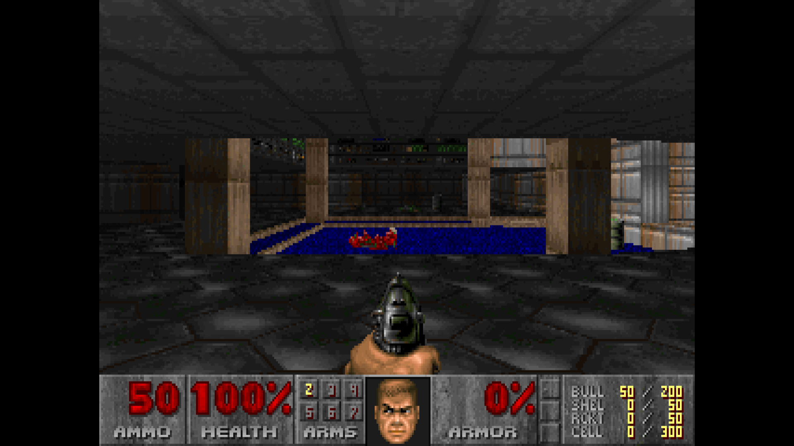 |
| Freedoom Phase 2, the free DOOM II episode | 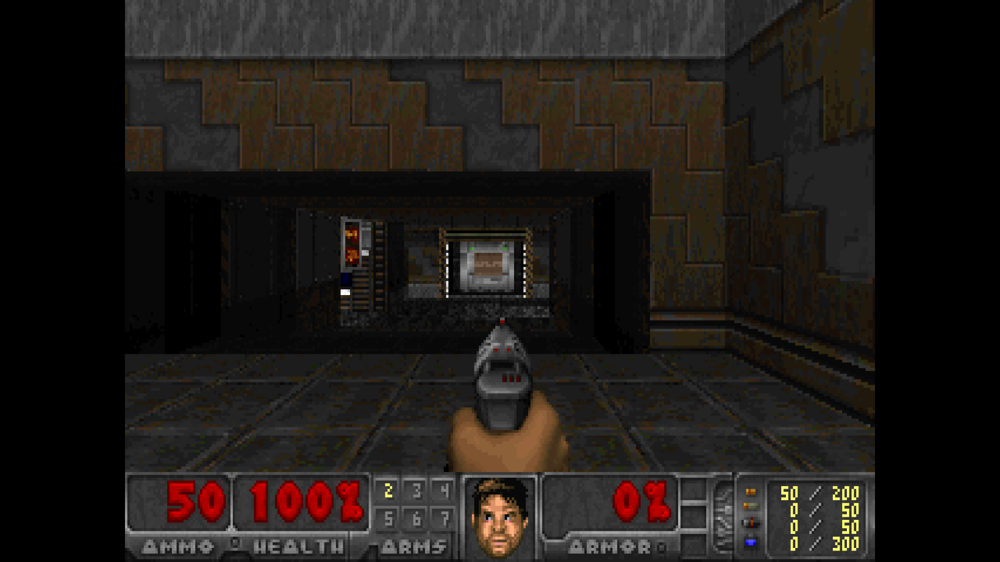 |
| id's Heretic shareware episode | 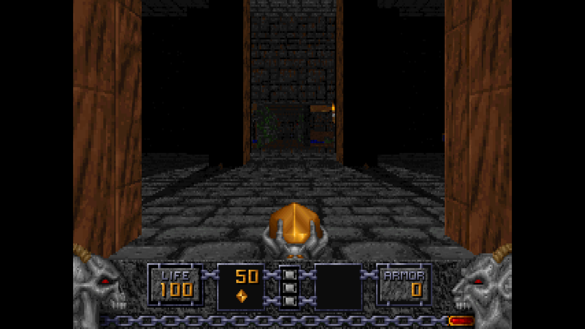 |
| id/Raven's Hexen demo | 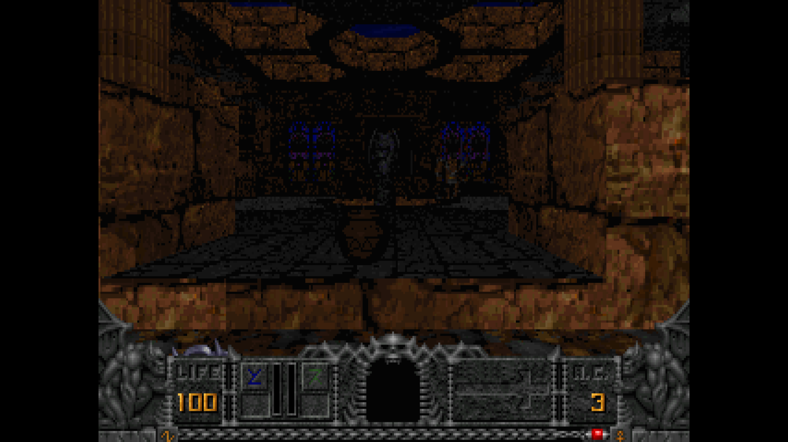 |
| id/Raven's Hexen II shareware | 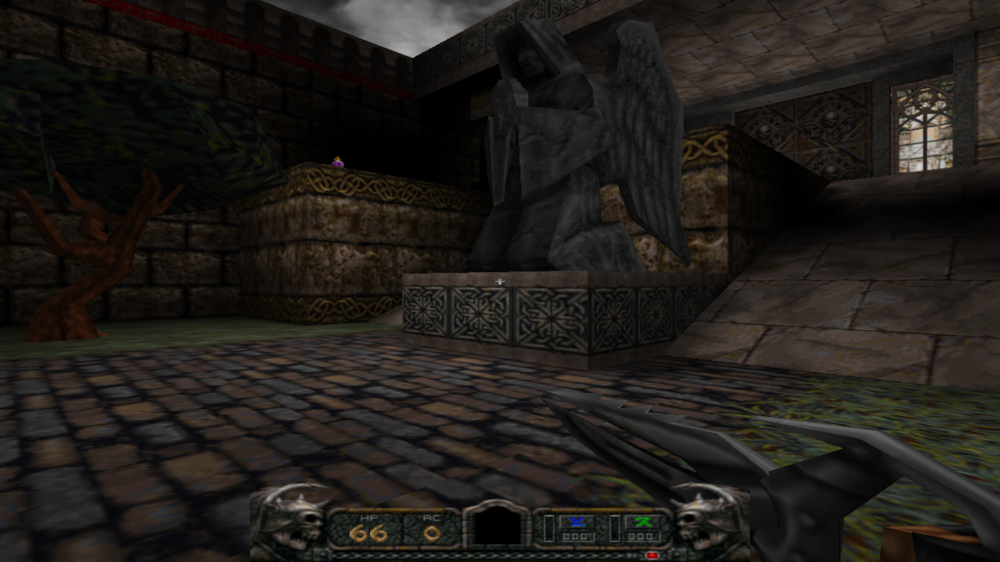 |
| id's Quake 1 shareware | 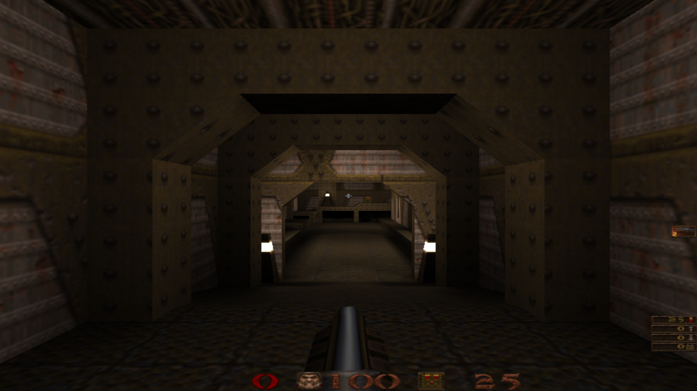 |
| id's QuakeWorld (2.30) | 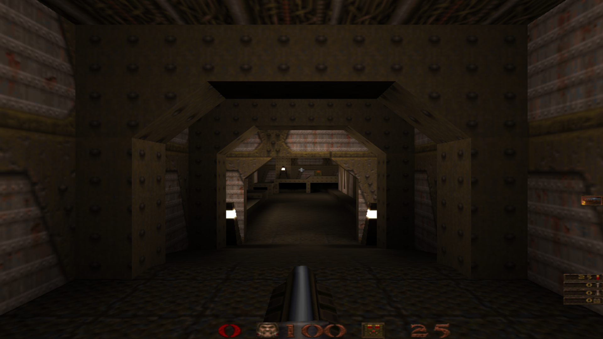 |
| id's Quake II demo (3.14) | 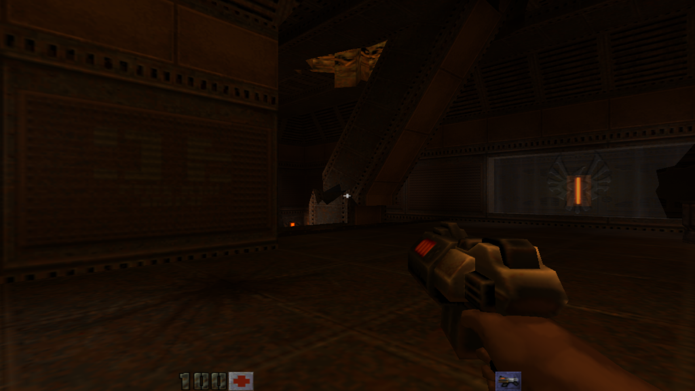 |
| id's Quake III Arena demo (1.11) | 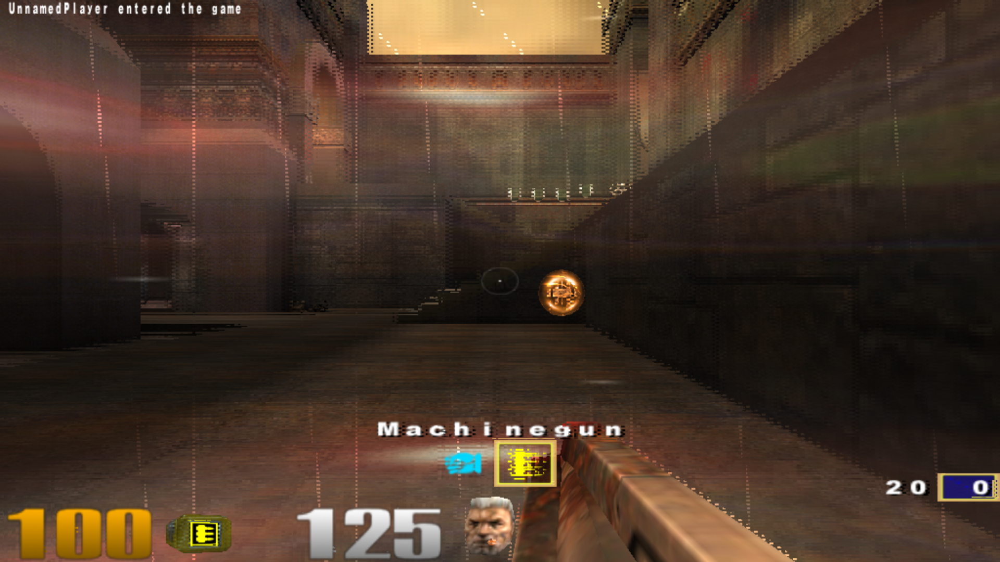 |
| LibreQuake, the free Quake data | 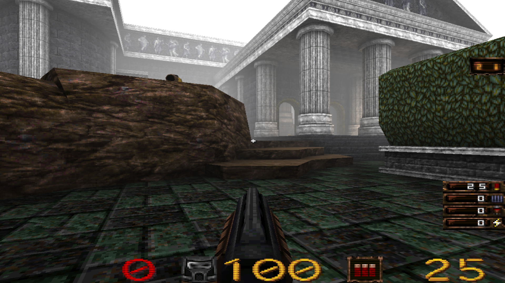 |
| OpenArena 0.8.8 | 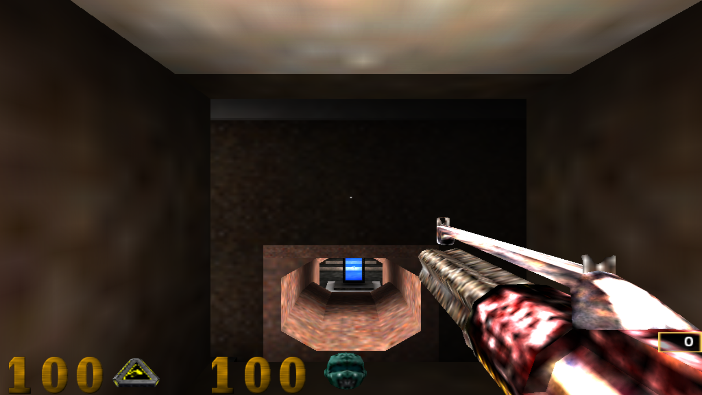 |
| Duke Nukem 3D Episode One | 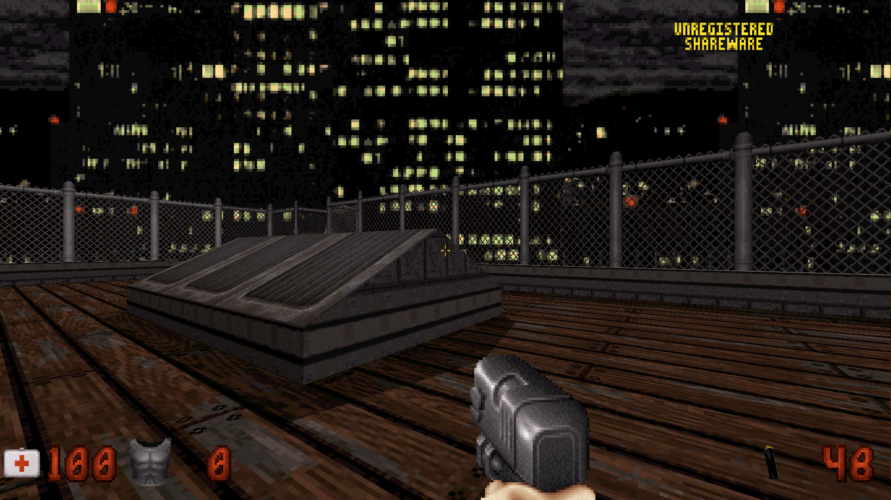 |
| Jazz Jackrabbit 1, Holiday Hare '94 | 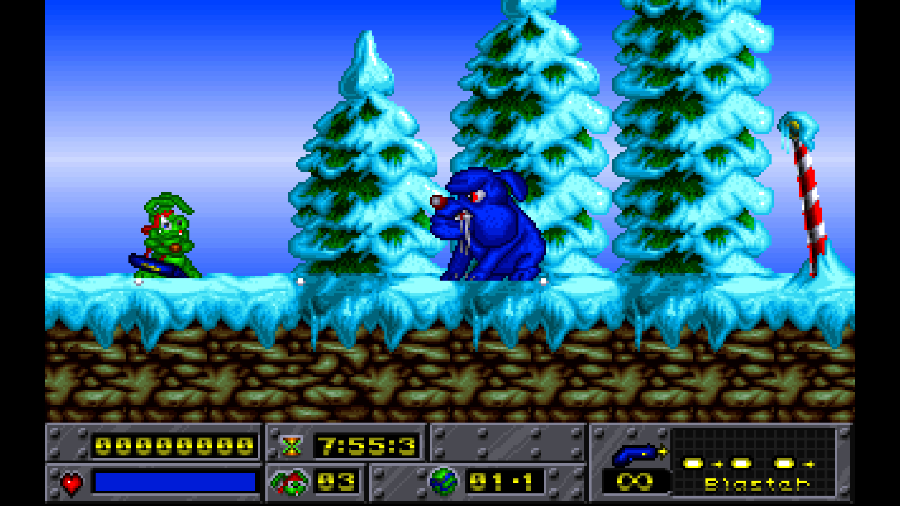 |
| Descent 1 shareware (v1.4), installed on the seat and not a recipe | 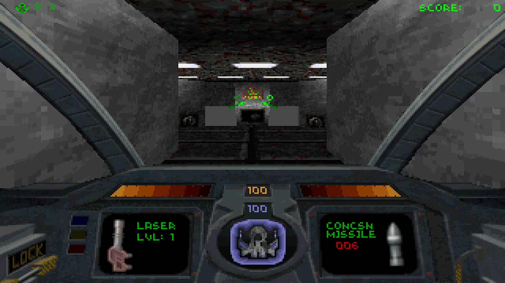 |
| Descent 2 Interactive Demo (v1.0), installed on the seat and not a recipe | 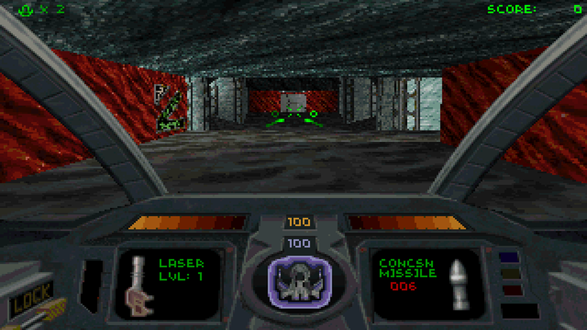 |
| Half-Life: Up-link, installed on the seat and not a recipe | 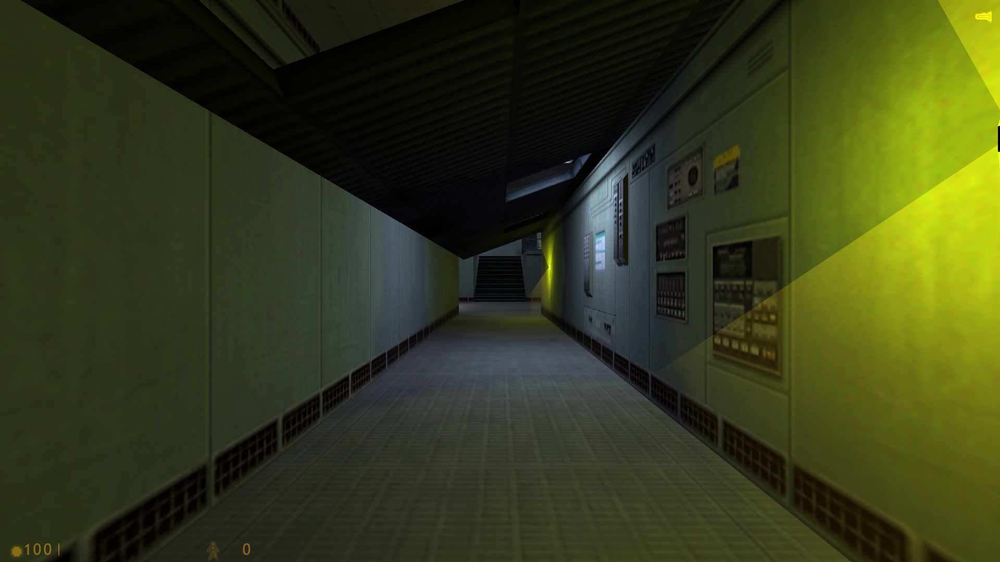 |
| id's Unreal Tournament 99 | 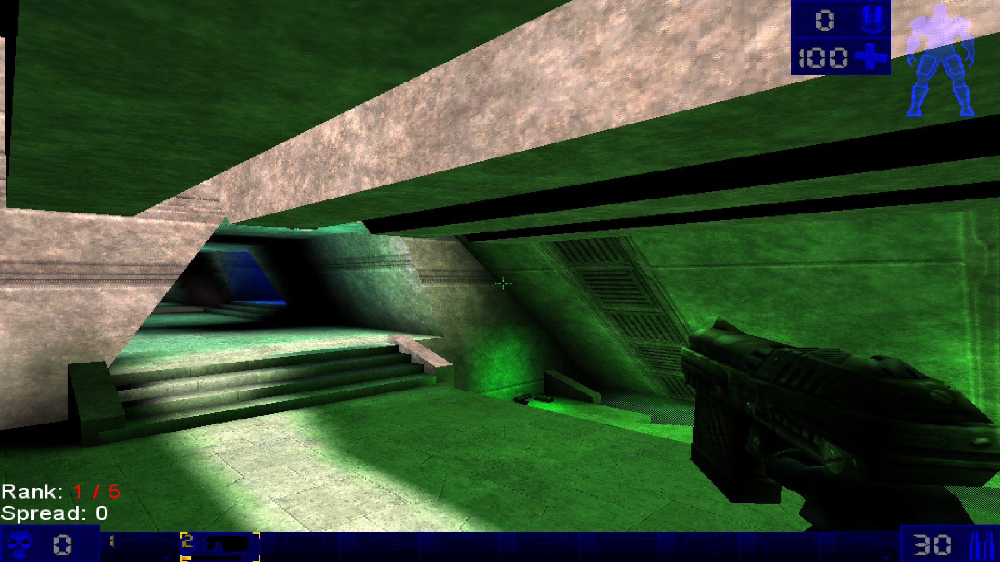 |
| id's Unreal / Unreal Gold | 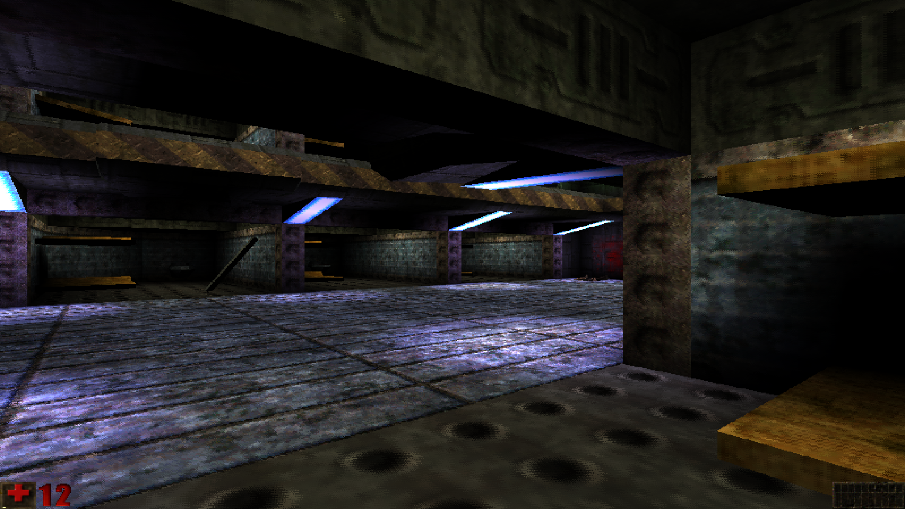 |

Dark and Darker and Destiny 2 have no dump here: they stream through OpenNOWLite
from the host's CloudMatch servers, and this retake round took only the games the
seat runs on its own.

The two Descent dumps fill the seat's whole 1920x1080 like every other dump here.
DOSBox-X cannot make its own window fill the screen on this seat - its `fullscreen`
setting segfaults weston twice over, `output = openglnb` is refused by the build, and
`windowresolution`, `windowmaximize` and the `[render]` scalers all leave it at a
640x417 `surface` window - so the picture was cropped out of the verified desktop
capture rather than retaken: `tools/doswindow.py` bounds the emulator's window from
the wallpaper's navy and gold fields and drops the 17 px menu strip DOSBox-X paints
inside it, which leaves the real 640x400 DOS frame, and that crop is stretched to
fill, the same full-bleed scale the emulator's own `aspect = false` applies.

## Games in the `scarthgap` branch

All of them live under `recipes-games/` on that branch - never under
`recipes-apps/`, which is the applications layer's directory. Each recipe has a
`README.md` next to it that states the command that actually runs the game on
the seat.

| Game | Recipe(s) | Engine it runs on |
| --- | --- | --- |
| DOOM shareware 1.9 | `doom1-demo` | Chocolate Doom |
| Freedoom Phase 2, the free DOOM II episode | `doom2-demo` | Chocolate Doom |
| Heretic episode 1 | `heretic1-demo` | Chocolate Doom |
| Hexen demo (4 levels) | `hexen-demo` | Chocolate Doom |
| Hexen II shareware demo | `hexen2-demo` | FTEQW |
| Quake 1 shareware episode | `quake1-demo` | FTEQW |
| QuakeWorld (2.30) | `quakeworld` | FTEQW, over the `quake1-demo` payload's `id1`: 212K of `qwprogs.dat`/`files.dat` out of id's own `q1source.zip` |
| Quake II demo (3.14) | `quake2-demo` | FTEQW, plus the aarch64 gamecode this layer compiles from id's GPLv2 sources |
| Quake III Arena demo (1.11) | `quake3-demo` | ioquake3, on the payload's `demoq3` tree |
| Duke Nukem 3D Episode One (v1.3d shareware) | `duke3d-demo` | EDuke32, CLASSIC software renderer |
| Jazz Jackrabbit 1, Holiday Hare '94 shareware | `jazz1-demo` | OpenJazz, reading Epic's original data in place |
| LibreQuake, the free Quake data | `librequake` | FTEQW |
| OpenArena 0.8.8 | `openarena` | FTEQW |
| Unreal Tournament 99 GOTY | `ut99` | OldUnreal's 469f arm64 engine, SoftDrv |
| Unreal / Unreal Gold | `unreal-gold` | the same 469f engine, with Gold's data inside it |
| Descent 1 shareware, Descent 2 Interactive Demo | no payload recipe: `dosbox-x` is the recipe, the trees are installed on the seat | DOSBox-X, the seat's only x86 DOS speaker |
| Half-Life: Up-link | no payload recipe: `xash3d-fwgs` is the recipe, the tree is installed on the seat | Xash3D FWGS as an OpenGL ES client |
| Dark and Darker, Destiny 2 | no payload recipe: `opennowlite` streams them | the CloudMatch stream itself is the host's |
| OpenNOW, OpenNOWLite | `opennow`, `opennowlite` | the CloudMatch clients: they sign the seat in and play, not a game of their own |

Jazz Jackrabbit 2 is the one game still wanting a recipe - its shareware payload
cannot be unpacked and the seat has no JJ2 engine to run one on - and its two
Descent and Up-link trees stay installed rather than shipped, which the dosbox-x
and xash3d-fwgs READMEs carry the licence/source reasons for.

The engines and clients above come with the dependency recipes the seat's stack
lacks: `libsdl3` under `recipes-multimedia/`, and the two host Rust recipes
under `recipes-devtools/`.

## Quick start

```bash
git checkout scarthgap
```

Then follow the build instructions in that branch's `README.md`.
