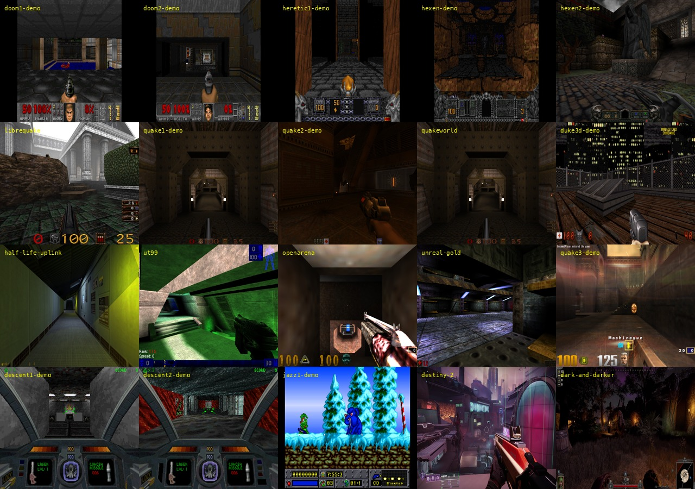

# meta-good-old-games

The good old games that run on embedded systems e.g STM32MP25x. The repository is
**one branch per Yocto release**: the branch carries the whole layer for that
series, and `main` is only this index page.

## Branches

| Branch | What is in it |
| --- | --- |
| `main` | this index page, and the sheet above |
| `scarthgap` | the whole layer for Yocto `scarthgap`: the engines, their patches, the free payloads, and each recipe's `README.md` plus its `PROOF.md` |

No other release branch exists yet; a new Yocto release gets a branch of its
own under its release name.

## The games

Every start frame the seat has, one sheet. Note: No game data is distributed in this git repo. 
This is only a collection of yocto recipies to install open source emulators, open source game engines, open/free source payloads games and open source streaming. 



| Game | What it is | Licence | Branch |
| --- | --- | --- | --- |
| id's DOOM shareware 1.9 | id's first episode, on Chocolate Doom over a `doom1.wad` installed by hand at `/gamedata/games/doom1` | shareware, id's own agreement | `scarthgap` |
| Freedoom Phase 2 | the free DOOM II-compatible episode, on Chocolate Doom over Freedoom's own 0.13.0 `freedoom2.wad`, by hand | free, Freedoom's own licence | `scarthgap` |
| id's Heretic shareware episode | id/Raven's first Heretic episode, on Chocolate Doom over `heretic1.wad`, by hand | shareware, id's own agreement | `scarthgap` |
| id/Raven's Hexen demo | the four-level Hexen demo, on Chocolate Doom over `hexen.wad`, by hand | demo, id's own release note | `scarthgap` |
| id/Raven's Hexen II shareware | the limited Hexen II set, on FTEQW over a `data1` tree, by hand | shareware under Activision's limited-use sublicense | `scarthgap` |
| id's Quake 1 shareware | id's first Quake episode, on FTEQW over an `id1` tree, by hand | shareware, id's own agreement | `scarthgap` |
| id's QuakeWorld (2.30) | id's QuakeWorld gamecode over that same `id1` data, on FTEQW, the `qw` pair beside it, by hand | shareware data plus GPL-2 gamecode, both id's | `scarthgap` |
| id's Quake II demo (3.14) | the Quake II demo, on FTEQW over a `baseq2` tree, by hand | demo, id's own release note | `scarthgap` |
| id's Quake III Arena demo (1.11) | the `demoq3` arena, on ioquake3 or on FTEQW over a `demoq3` tree, by hand | demo, id's own release note | `scarthgap` |
| Quake III: Team Arena | the `ta` missionpack, on ioquake3 over the owner's own copy, by hand | the owner's, and the user's own copy | `scarthgap` |
| Duke Nukem 3D Episode One (v1.3d) | the first Duke episode, on EDuke32's CLASSIC software renderer under `-j` over `DUKE3D.GRP`, by hand | shareware, 3D Realms' own agreement | `scarthgap` |
| Jazz Jackrabbit 1, Holiday Hare '94 | Epic/Apogee's platformer episode, on OpenJazz over Epic's original data directory, by hand | shareware, Epic's own `LICENSE.DOC` | `scarthgap` |
| Descent 1 shareware (v1.4) | Parallax/Interplay's DOS game on DOSBox-X, its DOS tree mounted in the emulator's own `[autoexec]`, by hand on the seat's `/gamedata` mount | shareware on Interplay's own words, but the copies on hand are not from an authorized source | `scarthgap` |
| Descent 2 Interactive Demo (v1.0) | the three-level Descent II demo, same route | demo on Interplay's own words, same source problem | `scarthgap` |
| Half-Life: Up-link | Sierra/Valve's 1999 GoldSrc mission on Xash3D FWGS as an OpenGL ES client, at `/gamedata/games/half-life-uplink`, by hand | none: the release carries copyright lines and no grant at all | `scarthgap` |
| Sven Co-op 4.8 | the free co-op mod on that same Xash3D route, needing no retail game | the mod's own free release | `scarthgap` |
| LibreQuake v0.09-beta | the free Quake data, installed by a recipe as an `id1` tree FTEQW reads | free, BSD-3 plus GPL-2 | `scarthgap` |
| OpenArena 0.8.8 | the free Quake III-style game, played by FTEQW | free, GPL-2 for program and data | `scarthgap` |
| id's Unreal Tournament 99 | the retail GOTY CD1 data on OldUnreal's 469f arm64 engine, drawn by SoftDrv, installed at `/gamedata/ut` and run by `ut99` | not free: Epic's Terms of Service, personal use only, not redistributed | `scarthgap` |
| id's Unreal / Unreal Gold | Gold's 1998 campaign run by that same 469f binary, at `/gamedata/ugt` | not free: Epic's Terms of Service, personal use only | `scarthgap` |
| id's Dark and Darker | streamed by OpenNOWLite off the host's CloudMatch servers, so nothing is ever downloaded here | free to play only, never free to download | `scarthgap` |
| Destiny 2 | the same stream, the same reason | free to play only, never free to download | `scarthgap` |

## Start here

```bash
git checkout scarthgap
```

That branch's `README.md` carries the build commands.
